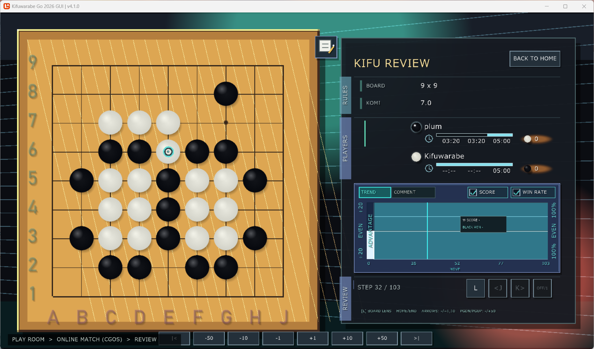

# 悪い実戦例：空き三角から団子石、餡子詰めへ（CGOS 第1706006局）

2026-11-26、利用者が「悪いパターンがいくつも出て参考になる」と指定した保存例。白のきふわらべが、自分で密集形を作り、囲まれた石を失い、取られた場所へ再び石を投入する流れを振り返る。

## 棋譜と確認できた事実

- 対局：CGOS 第1706006局、9路、コミ7。黒plum、白Kifuwarabe。
- 開始：2026-11-26 12:02:40 JST、終了12:07:45 JST。サーバー結果は黒47目勝ち（B+47.0）。
- [全103手のSGF棋譜](CGOS-1706006.sgf)。GTPで成功したplay/genmove応答から復元し、全103手を現行Board.Playで合法再生。2パス終局、GTPエラー0。
- 画像の32手目とログから復元した盤面が一致。白の最終手は32手目E6。
- 32手目にあった白16石は、33手目B4で左の6石、35手目H4で右の6石、77手目C9で上方へ伸びた連のうち残る4石を失い、すべて取られた。
- その後に打ち直した石もあるため、終局盤面に白石が一つもないという意味ではない。終局の白石は13石、黒の累計捕獲は35石、白の捕獲は0石。



以下の図は空点`.`、黒`x`、白`o`。数字は黒白を合わせた通算手数。I筋は省略する。

## 1. 10手目C3で空き三角を作る

白2手目C4、6手目D3に対して、白10手目C3を追加する。C4・C3・D3の白三石と空点D4が空き三角になる。石はつながったが、急いでつなぐ必要があったか、外へ働く別の候補があったかを比較したい場面。

```plaintext
  +-------------------+
9 | . . . . . . . . . |
8 | . . . . . . . . . |
7 | . . . . . . . . . |
6 | . . . x . x . . . |
5 | . . . . . . . . . |
4 | . . o . x . o . . |
3 | . . o o x o . . . |
2 | . . . x . . . . . |
1 | . . . . . . . . . |
  +-------------------+
    A B C D E F G H J
```

この形だけで敗因や禁止手と断定しない。捕獲、救出、切断防止など、必要な連絡がある場合は別に扱う。

## 2. 14手目D4で最小2×2の団子を完成する

白14手目D4で、C3・D3・C4・D4がすべて白になる。空き三角の空点を埋めたため三角の見た目は消えるが、中に眼のない2×2の団子へ変わっただけである。「空き三角が減ったから良い」と評価してはいけない具体例。

```plaintext
  +-------------------+
9 | . . . . . . . . . |
8 | . . . . . . . . . |
7 | . . . . . . . . . |
6 | . . . x . x . . . |
5 | . x . . . . . . . |
4 | . . o o x . o . . |
3 | . . o o x o o . . |
2 | . . . x . x . . . |
1 | . . . . . . . . . |
  +-------------------+
    A B C D E F G H J
```

さらに白18手目C5、20手目D5で、左側はC3:D5の2×3六石の塊となる。右側も白8手目F3、12手目G3、16手目F4、22手目F5、24手目G5などで密集し、32手目にはF3:G5の六石の塊になる。

## 3. フタ自身を囲まれ、32手目には左右ともアタリ

32手目の左右の白の塊には眼がなく、左の六石の呼吸点はB4だけ、右の六石はH4だけ。空いた地を守るはずの壁自身が、黒に囲まれている。

```plaintext
  +-------------------+
9 | . . . . . . . . . |
8 | . . . . . . x . . |
7 | . . o o o . . . . |
6 | . . x x o x x . . |
5 | . x o o x o o x . |
4 | . . o o x o o . . |
3 | . x o o x o o x . |
2 | . . x x . x x . . |
1 | . . . . . . . . . |
  +-------------------+
    A B C D E F G H J
```

黒33手目B4で左の白C3・D3・C4・D4・C5・D5を6石捕獲。白34手目C3のあと、黒35手目H4で右の白F3・G3・F4・G4・F5・G5も6石捕獲する。

| 捕獲手 | 取った側 | 今回の捕獲数 | 見る点 |
|---|---|---:|---|
| 33手目B4 | 黒 | 6 | 左の団子の唯一の呼吸点を埋める |
| 35手目H4 | 黒 | 6 | 右の団子も同様に取られる |
| 77手目C9 | 黒 | 9 | 32手目に上方に残っていた白4石も、この連に含まれて取られる |

77手目の9石には32手目以降に追加した白石も含まれる。32手目の白16石すべてを一度に取ったわけではない。

## 4. 取られたところへ再び打つ「餡子詰め」

左を取られた直後の白34手目C3、36手目D3、右を取られた後の白38手目F3、40手目G3、42手目F4など、捕獲された領域へ石を再投入している。周囲の黒を崩す読みや、生きる見通しの裏付けがなく中を埋め続ければ、利用者のいう「餡子詰め」になる。

白34C3・36D3の2石は黒47D4で取られ、白38F3・40G3・42F4に対応する3石も黒67G4で取られる。着手できる空点があるだけでは有効な侵入ではない。

「ペンキ塗り」「餡子詰め」はきふわらべの戦法を指す利用者の呼び名。相手の時間切れを待つ方針を、盤面で有利になる方針と混同しない。一方、侵入手を全面禁止する記事でもなく、具体的な応手と代替手で判断する。

## この棋譜から実装へ戻す確認項目

1. 着手候補の周囲だけで空き三角・団子・割かれ形の確認対象を拾い、盤全体の形の数だけを最適化しない。
2. 空き三角の第四点を埋める手を、単に「空き三角解消」として優遇しない。
3. 捕獲・救出・必要な連絡を例外として残し、代替候補の働きと比較する。
4. アタリになる前から、壁の呼吸点、眼を作る余地、外への逃走・連絡を読む。
5. 取られた領域への再侵入では、相手の応手を挟んで、生きる・取る・つながる見通しを検証する。

関連カード：［戦術#16］空き三角、［戦術#17］割かれ形、［戦術#18］コスミ、［戦術#19］ケイマ、［戦術#20］団子石。[カード台帳](../カード台帳.md)参照。この記事の保存は、新しい回避機能の本番配布や棋力向上の確認を意味しない。

## 出典と検証の範囲

画像：利用者提供「スクリーンショット 2026-11-26 122404.png」。保存画像は提供物をそのままコピーしたもの。

GTPログ：`D:\github.com\muzudho\KifuwarabeGo2026\Logs\Cgos\BlackPlayer\gtp-black-20261126-120240.log`。開始ログは思考エンジン2系、白の着手はgenmove wで確認。サーバーのsetup/gameover受信行で局IDと結果を照合した。認証通信は記事やSGFへ転載しない。

再生・検証用データ：`Z:\muzudho-with-ai-agent\KifuwarabeGoPolypropylene\tmp\delete-after-2026-12-03\lesson-cycle\20261126-122659-cgos-1706006-article`。期限付きNAS保存なので、記事に必要な全棋譜と図・画像はこのディレクトリーへ恒久保存した。

現行エンジンの暫定採点はB+44、CGOS結果はB+47.0で一致しない。正式な日本式死石処理などは未実装で、差の原因はこの記事では断定しない。各形が敗局に現れたことと、その一手を替えれば勝てたという因果は別であり、後者は未証明。
